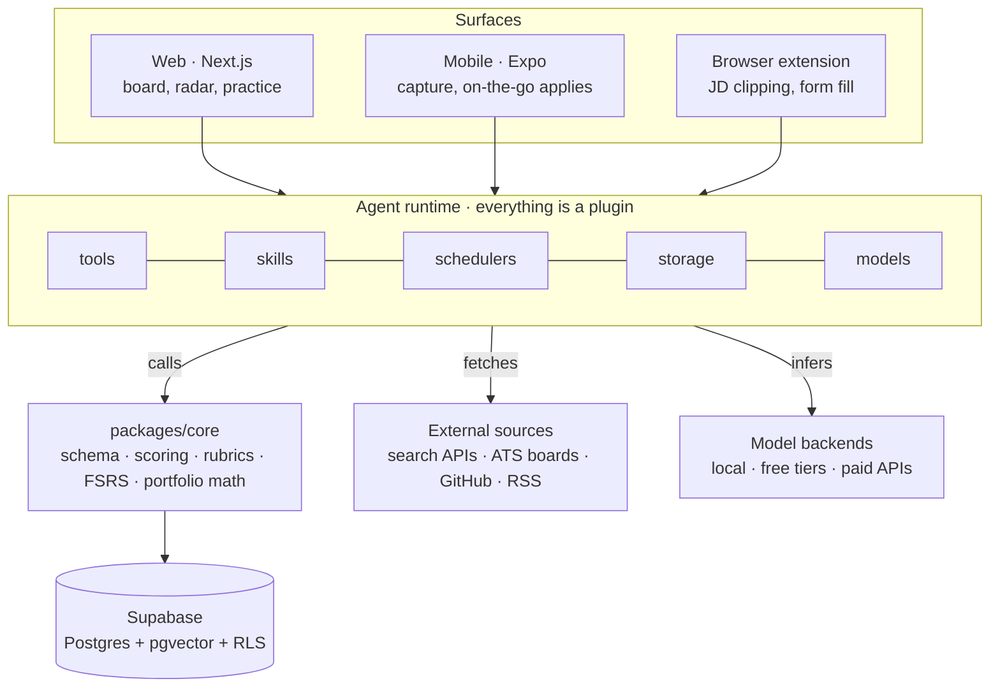

<div align="center">

# LFG

**Run your job search like a portfolio, not a spreadsheet.**

LFG turns a cross-border job search into a managed pipeline: it tracks every application,
researches every company, tailors every résumé to its source evidence, and converts the
things you learn along the way into interview reps you actually do.

[](docs/roadmap.md)
[](LICENSE)
[](docs/code-standards.md)
[](docs/launch.md)

[Documentation](docs/README.md) · [Architecture](docs/architecture.md) · [Roadmap](docs/roadmap.md) · [中文说明](README.zh-CN.md)

</div>

---

> [!WARNING]
> **Pre-alpha.** This repository currently contains design documents only — there is no
> runnable code yet. Phase 1 is in progress; see the [roadmap](docs/roadmap.md) for what
> lands when and the [architecture doc](docs/architecture.md) for how it is meant to fit
> together. Everything here is subject to change without notice.

## Table of contents

- [Why](#why)
- [What it does](#what-it-does)
- [Target markets](#target-markets)
- [Architecture at a glance](#architecture-at-a-glance)
- [Tech stack](#tech-stack)
- [Getting started](#getting-started)
- [Documentation](#documentation)
- [Roadmap](#roadmap)
- [Contributing](#contributing)
- [Security](#security)
- [License](#license)
- [Acknowledgements](#acknowledgements)

## Why

A serious cross-border job search produces three kinds of work, and spreadsheets only
help with the first:

1. **Bookkeeping.** Where did I apply, what stage is it in, who do I owe a follow-up?
2. **Research.** What does this company actually do, what is their real stack, who should
   I talk to, and will they sponsor a visa?
3. **Practice.** The lessons you pick up — a good answer, a recruiter's throwaway remark,
   a post that reframed how you pitch yourself — almost always die in a bookmarks folder.

Doing all three well for one application takes hours, so people either apply carefully to
very few roles or spray hundreds of generic ones. LFG's bet is that an AI-assisted
pipeline collapses the cost of the careful version, so that _careful_ and _at volume_ stop
being a trade-off. The second bet is that every one of those three activities produces
evidence, and that evidence — not self-assessment — is what should drive what you practise
next.

**Design principles**

| Principle                        | What it means in practice                                                                            |
| -------------------------------- | ---------------------------------------------------------------------------------------------------- |
| Evidence first                   | Every score and claim links back to the artefact it came from                                        |
| No fabrication                   | Résumé rewrites may reorder and re-emphasise, never invent; each bullet carries a `source_bullet_id` |
| Lawful collection                | Public APIs and user-pasted input only — no LinkedIn scraping                                        |
| Logic decoupled from the runtime | Business rules live in `packages/core`; the agent runtime only adapts                                |
| Cost bounded by design           | Tiered models, cached results, per-plugin daily caps, every call metered                             |
| Region-aware                     | Visa, language, résumé format and sourcing channels are first-class, not an afterthought             |

## What it does

Status key: ✅ shipped · 🚧 in progress · 📋 planned

- 📋 **Application pipeline** — kanban board over the real stages (saved → applied →
  assessment → interview → offer / rejected / ghosted), with stage history as the source
  of truth for every conversion metric.
- 📋 **Company intelligence** — a research agent produces a structured company profile
  (business lines, org shape, recent moves, inferred stack with confidence, talking
  points), cached for 30 days.
- 📋 **Résumé tailoring** — one JSON source of truth rendered per region, rewritten
  against a specific JD, presented as a diff you accept bullet by bullet.
- 📋 **Outreach** — role mapping per company, drafted first messages grounded in something
  the person actually wrote, and a follow-up cadence. Drafts only; you press send.
- 📋 **Competency radar** — eight axes scored from weighted, time-decayed evidence, with
  target-JD requirements overlaid so the gaps pick your next practice session.
- 📋 **Practice** — FSRS-scheduled flashcards, system-design mock interviews scored against
  a rubric, and a STAR story library tied to the competencies each story covers.
- 📋 **Insight library** — capture anything in three seconds from your phone's share sheet;
  it gets tagged, deduped, turned into a drill, and pushed back to you before the
  interview where it's relevant.
- 📋 **Portfolio risk dashboard** — concentration (industry _and_ region), pipeline
  coverage, stage conversion, sponsorship coverage, plus a weekly rebalance report.

Full behavioural spec: [`docs/product-spec.md`](docs/product-spec.md).

## Target markets

LFG is built for someone searching across several countries at once, which is why region
is a modelled dimension rather than a text field.

| Wave | Markets                                               | Why grouped                                                                    |
| ---- | ----------------------------------------------------- | ------------------------------------------------------------------------------ |
| 1    | 🇬🇧 United Kingdom (home base), 🇮🇪 Ireland, 🇪🇪 Estonia | English-language JDs, overlapping ATS platforms, EU/UK-style CV                |
| 1    | 🇯🇵 Japan                                              | Separate track: different résumé artefacts, agency-led funnel, language gating |
| 2    | 🇩🇪 Germany                                            | Added once the language-requirement handling from the Japan track generalises  |

Per-market visa routes, sourcing channels, résumé formats and etiquette:
[`docs/regions.md`](docs/regions.md).

## Architecture at a glance

Three layers. Surfaces capture and display, the agent runtime performs every AI action, and
`packages/core` owns the business rules both of them depend on.



Plugins never encode business rules; they translate parameters and call into `core`. Model
backends are swappable configuration, so no provider or model name appears in business
code. The reasoning behind each of these boundaries is recorded in
[`docs/adr/`](docs/adr/README.md).

## Tech stack

| Layer          | Choice                                               | Notes                                        |
| -------------- | ---------------------------------------------------- | -------------------------------------------- |
| Web            | Next.js, ECharts, dnd-kit                            | Board, radar charts, Sankey flow export      |
| Mobile         | Expo (React Native)                                  | Share-sheet capture, push, offline queue     |
| Data           | Supabase — Postgres, pgvector, Auth, RLS             | Every table carries `user_id` with RLS on    |
| Business logic | TypeScript `packages/core`                           | Shared by web, mobile and plugins            |
| Agent runtime  | DeepSeek Harness (pinned version)                    | Developer preview; adapter layer isolates it |
| Documents      | Typst                                                | Region-specific résumé PDF templates         |
| Scheduling     | Runtime scheduler plugins, Supabase cron as fallback | Weekly reports, signal scans, reminders      |

## Getting started

Node 22.12 or newer, npm 10 or newer, and Docker running for the local database.

```bash
git clone git@github.com:menomemo/LFG.git
cd LFG
npm install
npm run check
```

```bash
npm run db:start && npm run dev -w @lfg/web
```

Then open http://localhost:3000 and sign in as `alice@lfg.test` / `lfg-dev-password`, a
seeded local account. You get a read-only list of four applications — the walking skeleton,
which exists to prove the architecture runs rather than to be useful.

`npm run check` runs format, lint, types and tests, the same four checks CI runs and in the
same order. `npm run test:db` runs the row-level security isolation suite against the local
database. Setup in full, and the table of which standard is enforced by which tool, is in
[`docs/development.md`](docs/development.md); where the project has actually got to is in
[`docs/progress.md`](docs/progress.md).

## Documentation

| Document                                         | What it answers                                          |
| ------------------------------------------------ | -------------------------------------------------------- |
| [docs/README.md](docs/README.md)                 | Map of all documentation and how it's maintained         |
| [docs/progress.md](docs/progress.md)             | Where the project actually is, as a Gantt chart          |
| [docs/development.md](docs/development.md)       | Setup, commands, and what enforces which standard        |
| [docs/deployment.md](docs/deployment.md)         | What runs where, and how to get it there                 |
| [docs/architecture.md](docs/architecture.md)     | How the system is built, and why it is built that way    |
| [docs/product-spec.md](docs/product-spec.md)     | What each module does, with MVP and later scope          |
| [docs/data-model.md](docs/data-model.md)         | Tables, key fields, relationships, conventions           |
| [docs/regions.md](docs/regions.md)               | Per-market playbook: visas, channels, CV formats         |
| [docs/roadmap.md](docs/roadmap.md)               | Phases, release gates, what "done" means for each        |
| [docs/code-standards.md](docs/code-standards.md) | Google-derived TypeScript style, reviews, commits, tests |
| [docs/launch.md](docs/launch.md)                 | Shipping, compliance, distribution and growth            |
| [docs/learning-track.md](docs/learning-track.md) | The system-design and full-lifecycle learning goals      |
| [docs/adr/](docs/adr/README.md)                  | Architecture decision records                            |

## Roadmap

| Phase | Theme                                                                            | Gate to the next phase                                   |
| ----- | -------------------------------------------------------------------------------- | -------------------------------------------------------- |
| 1     | Foundation — datastore, pipeline board, insight capture, first plugin            | Four straight weeks with every application in the system |
| 2     | Precision applying — research agent, stack inference, tailored résumés, outreach | Five high-effort applications end to end                 |
| 3     | Capability — competency framework, radar, FSRS cards, mocks                      | Radar backed by real evidence, no self-assessment        |
| 4     | Risk — portfolio metrics, signal scanning, weekly report, insight sparring       | Two consecutive weekly reports acted on                  |
| 5     | Launch — public web signup, subscriptions, then the App Store                    | 20 active users who are not the author                   |

Each gate is "I used it for real for a week", not "the feature exists". Details and the
reasoning behind the ordering: [`docs/roadmap.md`](docs/roadmap.md).

## Contributing

The project is a single-author build-in-public effort right now, but issues and design
critique are genuinely welcome — especially from people searching in these markets.
Read [`CONTRIBUTING.md`](CONTRIBUTING.md) for workflow, commit format and review
expectations, and [`CODE_OF_CONDUCT.md`](CODE_OF_CONDUCT.md) for conduct.

## Security

Please do not open public issues for vulnerabilities. Reporting instructions and the
project's data-handling commitments are in [`SECURITY.md`](SECURITY.md).

## License

[MIT](LICENSE). AGPL-3.0 was considered first and rejected: its share-alike obligation
protects against a competing host, and there is nothing here yet worth that protection's
costs. The reasoning is in [ADR-0005](docs/adr/0005-choose-a-license.md).

## Acknowledgements

Standing on: [Supabase](https://supabase.com), [Next.js](https://nextjs.org),
[Expo](https://expo.dev), [ts-fsrs](https://github.com/open-spaced-repetition/ts-fsrs)
for the [FSRS](https://github.com/open-spaced-repetition/fsrs4anki) scheduler,
[ECharts](https://echarts.apache.org), [Typst](https://typst.app), and the open ATS job
board APIs that make lawful company research possible.

Documentation conventions borrowed from [standard-readme](https://github.com/RichardLitt/standard-readme),
[Keep a Changelog](https://keepachangelog.com), Michael Nygard's
[architecture decision records](https://cognitect.com/blog/2011/11/15/documenting-architecture-decisions),
and Oxide Computer's [RFD process](https://rfd.shared.oxide.computer/rfd/0001).
