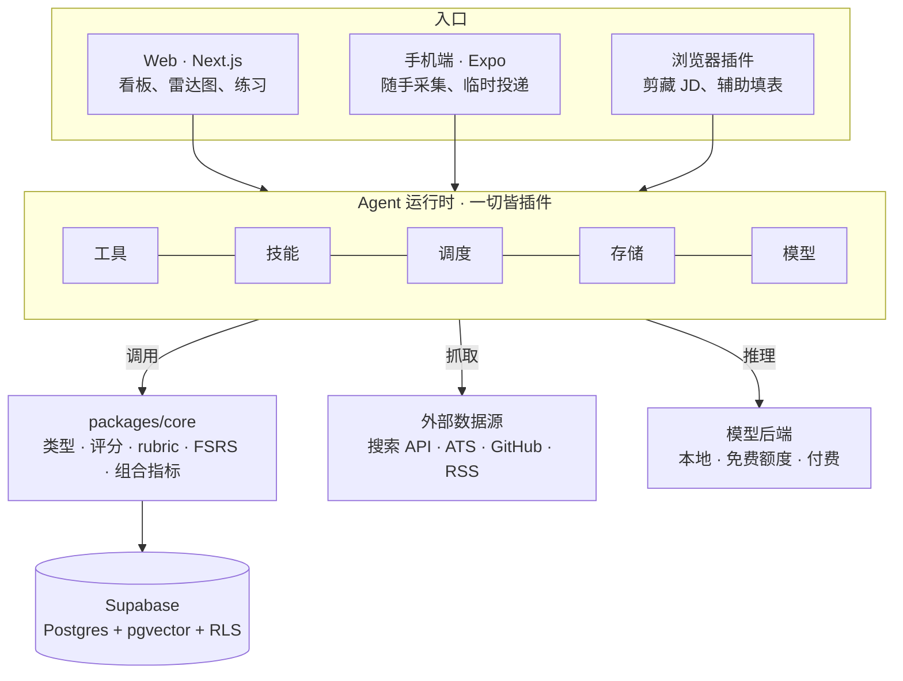

# LFG

**LFG是一个面向海外初级工程师的AI求职工作台，让求职从碰运气变成有策略的长期经营。市场瞬息万变，LFG助你快人一步。**

LFG想让求职不再是一场碰运气的数字游戏，而是一场由你掌控的长期经营。

借助AI，快速完成针对不同岗位的定制化准备，不必再在投递数量和质量之间二选一。每一次投递都有迹可循：哪些岗位更有机会？哪些公司更青睐你？求职流程卡在了哪一步？LFG帮你看清趋势、发现机会、及时调整策略，把日常积累的职场经验变成面试时真正用得上的优势。

[-blue)](docs/adr/0005-choose-a-license.md)

[文档](docs/README.md) · [架构](docs/architecture.md) · [路线图](docs/roadmap.md) · [English](README.md)

> 这是 [`README.md`](README.md) 的中文版。仓库其余文档均为英文；两份 README 需要同步更新。

---

> [!WARNING]
> **Pre-alpha。** 阶段 1 正在进行中：
> 什么时候交付什么见[路线图](docs/roadmap.md)，整体怎么搭见[架构文档](docs/architecture.md)。
> 这里的一切都可能随时变动。

## 目录

- [为什么做](#为什么做)
- [它做什么](#它做什么)
- [目标市场](#目标市场)
- [架构速览](#架构速览)
- [技术栈](#技术栈)
- [如何开始](#如何开始)
- [文档](#文档)
- [路线图](#路线图)
- [参与贡献](#参与贡献)
- [安全](#安全)
- [许可](#许可)
- [致谢](#致谢)

## 为什么做

认真做一次跨国求职会产生三类工作，而表格只能帮上第一类：

1. **记账。** 投了哪儿、现在什么阶段、哪一条该跟进了？
2. **调研。** 这家公司到底做什么、真实技术栈是什么、该找谁聊、愿不愿意担保签证？
3. **练习。** 你捡到的那些经验——一个好答案、HR 的一句随口评价、一篇让你换个角度讲自己的
   帖子——几乎都死在收藏夹里。

把这三件事为一次投递都做好要花几个小时，所以人们要么只精投很少几家，要么海投几百份模板。
LFG 的第一个赌注是：AI 辅助的流水线能把"精投"的成本打下来，于是**精**和**量**不再是取舍。
第二个赌注是：这三类工作每一类都在产生证据，而该由证据——不是自评——来决定你下一步练什么。

**设计原则**

| 原则 | 落到实践上是什么 |
| --- | --- |
| 积木化 | 每条事实带 `source_bullet_id`，便于快速重组 |
| 合规采集 | 只用公开接口和用户手动输入 |
| 逻辑与运行时解耦 | 业务规则放在 `packages/core`，agent 运行时只做适配 |
| 成本由设计约束 | 模型分层、结果缓存、每插件每日上限、每次调用都记账 |

## 它做什么

状态标记：🟢 已上线 · 🔴 进行中 · 🟡 计划中

-  **投递流水线** —— 按阶段（收藏 → 已投 → 笔试 → 面试 → offer / rejected / ghost）的看板。
-  **公司情报** —— 调研agent产出结构化档案（业务线、组织形态、近期动作、带置信度的技术栈推断、可聊的话题），缓存30天。
-  **简历定制** —— 针对具体 JD 改写，以 diff 形式逐条确认。
-  **人脉触达** —— 按公司做角色映射，基于对方业务起草第一条消息，附跟进。
-  **能力雷达** —— 8 根主轴，由带权重、带时间衰减的证据算出，叠加目标JD的要求，让差距决定下一次练习重点。
-  **练习** —— FSRS 调度的卡片、按 rubric 打分的系统设计 mock、标注了覆盖能力项的 STAR故事库。
-  **洞见库** —— 日常随心分享，融入职业准备。
-  **组合风险看板** —— 集中度（行业**和**地域）、pipeline 覆盖率、阶段转化率、担保覆盖率，外加每月一份调仓报告。

完整行为规格见 [`docs/product-spec.md`](docs/product-spec.md)。

## 目标市场

| 批次 | 市场 | 为什么归在一起 |
| --- | --- | --- |
| 1 | 🇬🇧 英国（现居） 🇮🇪 爱尔兰 🇪🇪 爱沙尼亚 | 英文 JD、ATS 平台重叠、欧式 CV |
| 1 | 🇯🇵 日本 | 简历材料不同、中介主导、语言 |
| 2 | 🇩🇪 德国 | 等待 |

各市场签证路径、招聘渠道、简历格式与礼节见 [`docs/regions.md`](docs/regions.md)。

## 架构速览

三层。入口负责采集和展示，agent 运行时执行所有 AI 动作，`packages/core` 承载两者共同依赖的
业务规则。

插件不写业务规则，只做参数转换并调用 `core`。模型后端是可替换的配置，记录在 [`docs/adr/`](docs/adr/README.md)。

## 技术栈

| 层 | 选择 | 说明 |
| --- | --- | --- |
| Web | Next.js、ECharts、dnd-kit | 看板、雷达图、桑基图导出 |
| 手机端 | Expo（React Native） | 系统分享菜单、推送、离线队列 |
| 数据 | Supabase —— Postgres、pgvector、Auth、RLS | 所有表带 `user_id` 并开启 RLS |
| 业务逻辑 | TypeScript `packages/core` | Web、手机端、插件共用 |
| Agent 运行时 | DeepSeek Harness（锁定版本） | 开发者预览阶段，由适配层隔离 |
| 文档渲染 | Typst | 按地域的简历 PDF 模板 |
| 定时任务 | 调度插件，Supabase cron 兜底 | 周报、信号扫描、提醒 |

## 如何开始

本地开发说明——前置依赖、`.env` 约定、Supabase 初始化、种子数据、
测试命令——会随阶段 1 一起进入 [`CONTRIBUTING.md`](CONTRIBUTING.md)。

如果你想在代码出现之前就对设计提意见，从 [`docs/architecture.md`](docs/architecture.md)
开始读，然后开一个 issue。

## 文档

| 文档 | 关于 |
| --- | --- |
| [docs/README.md](docs/README.md) | 全部文档的地图与维护规则 |
| [docs/architecture.md](docs/architecture.md) | 系统怎么搭的，以及为什么这么搭 |
| [docs/product-spec.md](docs/product-spec.md) | 每个模块做什么，MVP 与后续范围 |
| [docs/data-model.md](docs/data-model.md) | 表、关键字段、关联、约定 |
| [docs/regions.md](docs/regions.md) | 各市场手册：签证、渠道、简历格式 |
| [docs/roadmap.md](docs/roadmap.md) | 阶段、过关标准、每阶段"做完"的定义 |
| [docs/code-standards.md](docs/code-standards.md) | Google 风格的 TypeScript 规范、评审、提交、测试 |
| [docs/launch.md](docs/launch.md) | 上架、合规、分发与增长 |
| [docs/learning-track.md](docs/learning-track.md) | system design 与开发全链条的学习目标 |
| [docs/adr/](docs/adr/README.md) | 架构决策记录 |

## 路线图

| 阶段 | 主题 | 过关标准 |
| --- | --- | --- |
| 1 | 底座 —— 数据层、投递看板、洞见采集、第一个插件 | 连续四周所有投递都在系统里 |
| 2 | 精投 —— 调研 agent、技术栈推断、定制简历、触达 | 五次重仓投递全流程跑通 |
| 3 | 能力 —— 能力框架、雷达图、FSRS 卡片、mock | 雷达图上的分数全部有真实证据，无自评 |
| 4 | 风险 —— 组合指标、信号扫描、周报、洞见对练 | 连续两份周报真的改变了投递动作 |
| 5 | 上架 —— Web 公开注册、订阅，然后 App Store | 20 个不是作者本人的活跃用户 |

细节和排序理由见
[`docs/roadmap.md`](docs/roadmap.md)。

## 参与贡献

目前是单人 build in public，但非常欢迎 issue 和设计层面的批评——特别是正在欧陆求职的大家。工作流、提交格式和评审要求见 [`CONTRIBUTING.md`](CONTRIBUTING.md)，行为准则见
[`CODE_OF_CONDUCT.md`](CODE_OF_CONDUCT.md)。

## 安全

请不要在公开 issue 里报告漏洞。上报方式和本项目的数据处理承诺见
[`SECURITY.md`](SECURITY.md)。

## 许可

尚未确定。[ADR-0005](docs/adr/0005-choose-a-license.md) 提议 AGPL-3.0；在该 ADR 被接受、
`LICENSE` 文件提交之前，**未授予任何许可**，保留所有权利。

## 致谢

感谢：[Supabase](https://supabase.com)、[Next.js](https://nextjs.org)、
[Expo](https://expo.dev)、提供 [FSRS](https://github.com/open-spaced-repetition/fsrs4anki)
调度的 [ts-fsrs](https://github.com/open-spaced-repetition/ts-fsrs)、
[ECharts](https://echarts.apache.org)、[Typst](https://typst.app)，以及那些让合规的公司调研成为可能的公开 ATS job board 接口。

文档规范参考了 [standard-readme](https://github.com/RichardLitt/standard-readme)、
[Keep a Changelog](https://keepachangelog.com)、Michael Nygard 的[架构决策记录](https://cognitect.com/blog/2011/11/15/documenting-architecture-decisions)，
以及 Oxide Computer 的 [RFD 流程](https://rfd.shared.oxide.computer/rfd/0001)。
