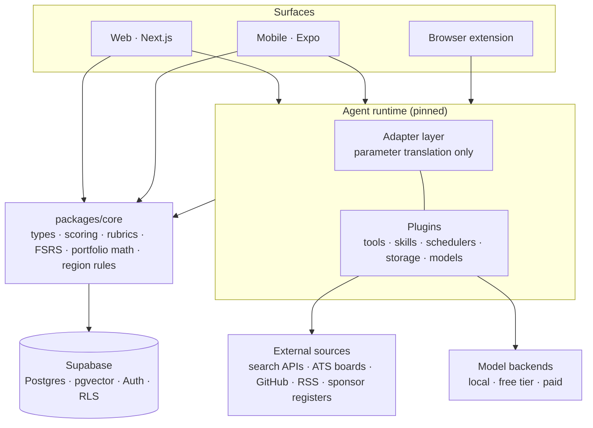
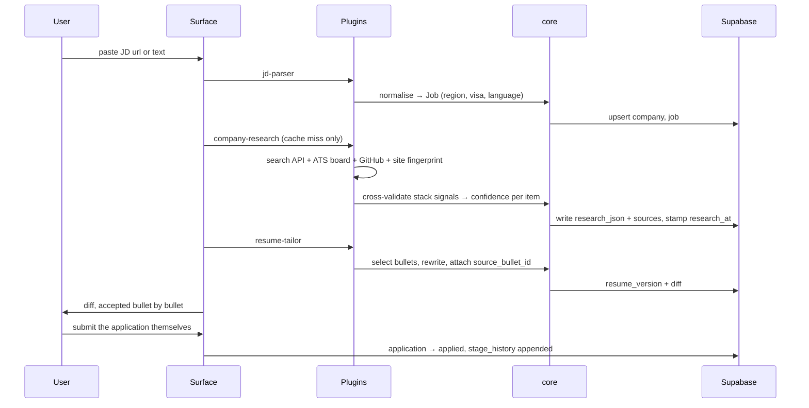

# Architecture

|                   |                             |
| ----------------- | --------------------------- |
| **Status**        | Draft — Phase 1 in progress |
| **Author**        | @Yihong                     |
| **Created**       | 2026-11-04                  |
| **Last reviewed** | 2026-11-04                  |
| **Decisions**     | [ADR index](adr/README.md)  |

This is the system-level design document: structure, boundaries, and the reasoning behind
both. Behaviour lives in [product-spec.md](product-spec.md); the schema lives in
[data-model.md](data-model.md).

## 1. Context

A cross-border job search is three jobs at once — bookkeeping, research, and deliberate
practice — and the three share data that nothing on the market joins up. Trackers hold
stages but know nothing about the company. Research tools produce prose nobody re-reads.
Interview-prep tools drill questions disconnected from the roles actually in the pipeline.

The first user is the author: based in the United Kingdom, targeting SDE and AI Engineer
roles at graduate/junior level across the UK, Ireland, Estonia and Japan, with Germany
behind them. That user is searching in four markets simultaneously, which is the detail
that shapes the data model more than any other.

The system is designed for one user first and multi-tenant from the first migration, so
that going public is a deployment change rather than a rewrite.

## 2. Goals

1. One application's full cycle — capture, research, tailor, apply, follow up, debrief —
   takes minutes of human attention, not hours, without the output becoming generic.
2. Every number the UI shows is traceable to the artefact that produced it.
3. Region differences (visa, language, résumé artefact, sourcing channel) are handled by
   the system, not remembered by the user.
4. Running cost for a single user stays near zero; cost scales sublinearly with users.
5. A structural change in the agent runtime — a developer-preview dependency — costs a
   rewrite of the adapter layer only.

### Non-goals

- **Not an auto-applier.** The system prepares material and drafts messages; a human
  presses send and submits forms. This is a product stance, not a technical limit.
- **Not a scraper.** No LinkedIn automation, no credentialed scraping, no bot-detection
  evasion. Public APIs and user-pasted content only.
- **Not a model-training project.** "Customisation" means configuring plugins and prompts.
  No weights are trained or fine-tuned.
- **Not a general CRM or ATS.** It models one person's search, not a recruiting team's.
- **No multi-region infrastructure.** Markets are a data dimension; the deployment stays in
  one region.

## 3. Constraints

| Constraint                                              | Consequence                                                                                                                        |
| ------------------------------------------------------- | ---------------------------------------------------------------------------------------------------------------------------------- |
| Single developer, evenings and weekends                 | Boring, well-documented technology; no component we would have to operate ourselves                                                |
| Agent runtime is in developer preview                   | Version pinned, adapter layer isolated, regression tests per plugin ([ADR-0003](adr/0003-keep-business-logic-in-packages-core.md)) |
| Inference is paid for by us, not the user               | Tiered models, aggressive caching, per-plugin caps, every call metered                                                             |
| Résumé and interview content is sensitive personal data | Row-level security from the first migration; GDPR applies in the UK, IE, EE and DE                                                 |
| Free tiers and model prices change monthly              | No provider or model name in business code; backends are configuration                                                             |

## 4. System overview



### Layer responsibilities

| Layer           | Owns                                                                                      | Must never                                             |
| --------------- | ----------------------------------------------------------------------------------------- | ------------------------------------------------------ |
| Surfaces        | Capture, display, confirmation of anything irreversible                                   | Hold business rules or talk to model backends directly |
| Adapter layer   | Translating runtime plugin calls into `core` calls                                        | Contain a rule worth testing on its own                |
| Plugins         | Fetching, prompting, multi-step agent work                                                | Encode scoring, scheduling or region logic             |
| `packages/core` | Every rule: schema types, scoring, rubrics, FSRS wiring, portfolio metrics, region policy | Import anything runtime-specific                       |
| Supabase        | Storage, auth, tenancy enforcement, cron fallback                                         | Be bypassed by a surface writing with a service key    |

The sharp version of the rule: **if a behaviour deserves a unit test, it belongs in
`core`.** The adapter layer exists so that a breaking runtime release is a day of work
instead of a month ([ADR-0003](adr/0003-keep-business-logic-in-packages-core.md)).

### Repository layout

```
apps/web/          Next.js web client
apps/mobile/       Expo app (from Phase 1's capture flow onward)
packages/core/     Business logic. No runtime or framework imports.
packages/adapters/ Agent-runtime adapter layer
plugins/<name>/    One directory per plugin, with its own regression tests
supabase/          Migrations, seed data, RLS policies
docs/              This documentation
```

## 5. Key flows

### 5.1 Precision apply



Two invariants in this flow. **Caching:** a company profile is served from the database for
30 days and a JD is parsed exactly once, keyed on normalised source URL plus body hash.
**Provenance:** no bullet reaches a PDF without a `source_bullet_id`, and no profile field
reaches the UI without a source link and a confidence value.

### 5.2 Insight capture

The capture path is optimised for three seconds of attention: the mobile share sheet or a
paste box writes a raw row immediately and returns. Everything else — extraction, tagging
to sales dimensions, embedding, dedupe clustering, drill generation, FSRS card creation —
happens asynchronously. If the device is offline the row queues locally and syncs later, so
the write path must be idempotent on a client-generated id.

### 5.3 Scheduled work

Scheduler plugins own the recurring jobs: signal scans over target companies' ATS boards,
the weekly portfolio report, follow-up and `next_action_at` reminders, the daily review
queue. Supabase cron is the fallback so that reminders survive a runtime outage — a missed
follow-up is a real cost, a missed signal scan is not.

## 6. Data architecture

One Postgres database, pgvector for embeddings, `applications` as the hub, `evidence` as
the table that makes the competency radar possible. Full field lists, relationships and
conventions are in [data-model.md](data-model.md). The three conventions that matter at
the architecture level:

- **Tenancy.** Every table carries `user_id` and has RLS enabled from its first migration.
  Surfaces use the user's token; the service key is confined to scheduler plugins, which
  pass an explicit user context ([ADR-0002](adr/0002-use-supabase-as-the-primary-datastore.md)).
- **Provenance.** AI-written fields carry `generated_by` and a source link. This is enforced
  by the column being `NOT NULL`, not by discipline.
- **Region.** `region` is an enum (`uk`, `ie`, `ee`, `jp`, `de`, `other`) on companies, jobs
  and applications, and it drives résumé template selection, reminder phrasing, metric
  slicing and visa warnings ([ADR-0004](adr/0004-treat-region-as-a-first-class-dimension.md)).

## 7. Cross-cutting concerns

### Cost control

Four mechanisms, in order of how much they save:

1. **Caching.** Company profiles for 30 days; one parse per JD; stable system prompts so
   provider-side prompt caching applies.
2. **Tiering.** Light work (tagging, extraction, short drafts) runs on cheap or free
   models; only research, mock interviews and reports use a strong one. The tier is
   declared per plugin, in [product-spec.md](product-spec.md).
3. **Caps.** Every plugin declares a daily call ceiling and a maximum step count, so an
   agent loop cannot run away overnight.
4. **Metering.** Every call writes to `llm_usage` with tokens and cost. Unmetered calls are
   a bug, because without that table the first three mechanisms cannot be tuned.

### Observability

Per-plugin structured logs keyed by a run id; `llm_usage` as the cost and volume ledger;
the pipeline metrics in the risk dashboard double as product telemetry. Error tracking and
uptime monitoring are deliberately deferred to Phase 5 — see
[learning-track.md](learning-track.md), where they are part of the lifecycle goal.

### Failure modes

| Failure                            | Behaviour                                                                                                             |
| ---------------------------------- | --------------------------------------------------------------------------------------------------------------------- |
| Model backend down or rate-limited | Fall back down the tier ladder, then queue; never block a user-initiated apply on inference                           |
| Agent runtime breaking change      | Pinned version keeps production working; adapter layer absorbs the migration                                          |
| External source unavailable        | Profile is written with the fields that succeeded, each marked with its own confidence; partial is better than absent |
| Research produces nothing credible | Return "unknown" rather than a guess — the no-fabrication rule outranks completeness                                  |
| Offline capture                    | Local queue, idempotent sync on a client-side id                                                                      |

### Compliance and privacy

GDPR applies across the UK, Ireland, Estonia and Germany. Consequences already baked in:
the data is the user's own, export and delete are features and not favours, third-party
contact details are only ever user-entered or from a public professional source, and
nothing is sent on a user's behalf. The collection stance is in
[SECURITY.md](../SECURITY.md).

## 8. Deployment

| Environment      | Models                         | Data                          | Purpose                                                        |
| ---------------- | ------------------------------ | ----------------------------- | -------------------------------------------------------------- |
| Local            | Local models, zero cost        | Local Supabase, seed data     | Development and plugin regression tests                        |
| Personal         | Free tiers and student credits | Production database, one user | The author's real search — this is the one that must not break |
| Public (Phase 5) | Free tier plus paid, metered   | Multi-tenant, same schema     | Signups, subscriptions                                         |

Hosted by us, so users never configure an API key. The mobile app ships via TestFlight for
personal use long before it goes near the App Store; the public web app comes first. See
[launch.md](launch.md).

## 9. Alternatives considered

| Instead of                               | We would get                         | Rejected because                                                                                                                                                       |
| ---------------------------------------- | ------------------------------------ | ---------------------------------------------------------------------------------------------------------------------------------------------------------------------- |
| Supabase                                 | Self-hosted Postgres plus a backend  | Auth, RLS and pgvector in one managed box is most of Phase 1 for free; the exit path is plain Postgres ([ADR-0002](adr/0002-use-supabase-as-the-primary-datastore.md)) |
| Business logic inside plugins            | Less indirection, faster first build | A preview-stage runtime would own our scoring and rubrics; every breaking change would be a rewrite                                                                    |
| A Telegram bot for capture               | A capture path in a weekend          | The share sheet is faster at the moment that matters, and two capture surfaces is double maintenance for one user                                                      |
| Separate services per module             | Independent scaling                  | One user, one developer; a monolith with hard internal boundaries is the honest choice, and the boundaries are where a split would go                                  |
| Spreadsheet-grade regions (a text field) | Nothing to design                    | Visa and language constraints have to participate in matching and alerting, which a free-text field cannot do                                                          |

## 10. Open questions

| Question                                                                                   | Blocks                       | Needed by                                                                |
| ------------------------------------------------------------------------------------------ | ---------------------------- | ------------------------------------------------------------------------ |
| Can the runtime's UI plugin host the board and radar, or does the web app own all display? | Phase 1 surface split        | Start of Phase 1                                                         |
| iOS or Android first for the mobile capture path?                                          | Mobile MVP                   | Phase 1 capture work                                                     |
| Does AI Engineer need a ninth competency axis for model evaluation?                        | Competency framework content | Phase 3                                                                  |
| Does the repository go public before or after launch?                                      | Build-in-public timing       | Phase 4. Licence settled: MIT ([ADR-0005](adr/0005-choose-a-license.md)) |
| Where do the first external users come from?                                               | Phase 5                      | Phase 4                                                                  |

## 11. Risks

| Risk                                | Impact                                                    | Mitigation                                                               |
| ----------------------------------- | --------------------------------------------------------- | ------------------------------------------------------------------------ |
| Runtime breaking changes            | Plugins stop working                                      | Pin the version, regression-test each plugin, keep logic in `core`       |
| Free tiers tighten                  | Personal-use cost rises                                   | Swappable backends, local models always viable                           |
| Scope outruns the time available    | A half-built product                                      | Phase gates are "used it for real for a week", not "feature exists"      |
| Competency framework is low quality | A radar that misleads its only user                       | Ship two axes first, calibrate against real interview feedback           |
| Collection crosses a line           | Account bans or legal exposure                            | Public APIs and user input only; the stance is a non-goal, not a setting |
| AI fabricates résumé content        | Reputational damage, in the one place it cannot be risked | Provenance columns are `NOT NULL`; diffs accepted bullet by bullet       |
| Building replaces applying          | The product succeeds, the job search fails                | Phase gates are defined in terms of the author's actual search           |
