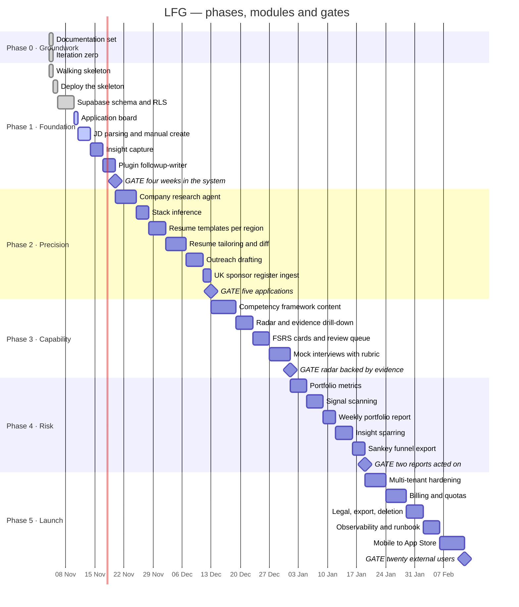

# Progress

|                                                                                            |                                                           |
| ------------------------------------------------------------------------------------------ | --------------------------------------------------------- |
| **Updated**                                                                                | 2026-11-05                                                |
| **Phase**                                                                                  | 1 of 5 — Foundation                                       |
| **Next**                                                                                   | Finishing the board: an optimistic move and drag-to-stage |
| Where the project actually is, against the whole picture. This document is updated **every |
| time a module is finished** — see [Update protocol](#update-protocol). It is the only      |
| document that tracks state rather than intent, which is why it is separate from            |
| [roadmap.md](roadmap.md): the roadmap says what the plan is, this says where we got to.    |

## Right now

|                                                                                            |                                                                                                                                                                                                                                      |
| ------------------------------------------------------------------------------------------ | ------------------------------------------------------------------------------------------------------------------------------------------------------------------------------------------------------------------------------------ |
| **Done**                                                                                   | Documentation set · iteration zero · walking skeleton · **deployed and serving** at [letsfreakingo.netlify.app](https://letsfreakingo.netlify.app) · the full Supabase schema, fifteen tables with RLS and a 55-test isolation suite |
| **In progress**                                                                            | The application board again: the move is slow enough to notice, and a card cannot be dragged between lanes                                                                                                                           |
| **Not done**                                                                               | Dragging a card between lanes — a stage is chosen from a select and submitted. Nothing is extracted from a job advert yet                                                                                                            |
| **Blocked on a decision**                                                                  | Can the agent runtime's UI plugin host the board and radar? ([architecture.md §10](architecture.md#10-open-questions))                                                                                                               |
| **Phase 1 gate**                                                                           | Reachable for the first time, and not started: four consecutive weeks with every application in the system                                                                                                                           |
| Progress through the whole plan: **5 of 29 tracked items complete.** The board was marked  |
| complete against what had been built rather than against how the item is defined:          |
| [roadmap.md](roadmap.md) says "application board with drag-to-stage", and dragging a card  |
| was not built. It is back to in progress until it is. The board is usable in the meantime, |
| so the Phase 1 gate is still something that can be attempted.                              |

## Gantt

Weeks are estimates and shift; the gates do not. `done` is complete, `active` is in
progress, everything else is planned.

## Whole picture

Every tracked item, so position is visible without reading the chart.
Status key: ✅ done · 🚧 in progress · 📋 planned · ⛔ blocked

| Phase | Item                          | Status | Notes                                                                                                                       |
| ----- | ----------------------------- | ------ | --------------------------------------------------------------------------------------------------------------------------- |
| 0     | Documentation set             | ✅     | 2026-11-04                                                                                                                  |
| 0     | Iteration zero                | ✅     | 2026-11-04 · workspace, lint, CI, `@lfg/core` with 36 tests                                                                 |
| 1     | Walking skeleton              | ✅     | 2026-11-04 · sign-in → RLS-protected query → `core` derivation → rendered page, locally                                     |
| 1     | Deploy the skeleton           | ✅     | 2026-11-05 · live on Netlify against production Supabase. Anonymous request redirects to sign-in; 30s from merge to serving |
| 1     | Supabase schema and RLS       | ✅     | 2026-11-05 · fifteen tables, four policies each, cross-tenant checks on every parent, 55-test isolation suite               |
| 1     | Application board             | 🚧     | 2026-11-05 · lanes, create and stage changes ship; the item is defined with drag-to-stage, which does not                   |
| 1     | JD parsing and manual create  | 🚧     | Manual create shipped with the board. What is left is extracting the fields from a pasted advert                            |
| 1     | Insight capture               | 📋     | Web paste box, then the mobile share sheet                                                                                  |
| 1     | `followup-writer` plugin      | 📋     | First plugin, with a regression test                                                                                        |
| 2     | Company research agent        | 📋     |                                                                                                                             |
| 2     | Stack inference               | 📋     |                                                                                                                             |
| 2     | Résumé templates per region   | 📋     | UK/IE and Japan first                                                                                                       |
| 2     | Résumé tailoring and diff     | 📋     |                                                                                                                             |
| 2     | Outreach drafting             | 📋     |                                                                                                                             |
| 2     | UK sponsor register ingest    | 📋     | The only market with an authoritative list                                                                                  |
| 3     | Competency framework content  | 📋     | Two axes first, then the rest                                                                                               |
| 3     | Radar and evidence drill-down | 📋     |                                                                                                                             |
| 3     | FSRS cards and review queue   | 📋     |                                                                                                                             |
| 3     | Mock interviews with rubric   | 📋     |                                                                                                                             |
| 4     | Portfolio metrics             | 📋     | HHI already implemented in `core`                                                                                           |
| 4     | Signal scanning               | 📋     |                                                                                                                             |
| 4     | Weekly portfolio report       | 📋     |                                                                                                                             |
| 4     | Insight sparring              | 📋     |                                                                                                                             |
| 4     | Sankey funnel export          | 📋     | Also the distribution channel ([launch.md](launch.md#distribution))                                                         |
| 5     | Multi-tenant hardening        | 📋     |                                                                                                                             |
| 5     | Billing and quotas            | 📋     |                                                                                                                             |
| 5     | Legal, export, deletion       | 📋     | GDPR in four jurisdictions                                                                                                  |
| 5     | Observability and runbook     | 📋     |                                                                                                                             |
| 5     | Mobile to App Store           | 📋     | Web goes public first                                                                                                       |

## Gates

A gate is passed by use, not by the feature existing. None are passed.

| Gate  | Criterion                                                        | Status |
| ----- | ---------------------------------------------------------------- | ------ |
| 1 → 2 | Four consecutive weeks with every application in the system      | 📋     |
| 2 → 3 | Five tier-A applications end to end, one with Japanese documents | 📋     |
| 3 → 4 | Every radar score traces to real evidence, no self-assessment    | 📋     |
| 4 → 5 | Two consecutive weekly reports that changed what got applied to  | 📋     |
| 5     | Twenty active users who are not the author                       | 📋     |

## Update protocol

**When a module is finished, update this document in the same pull request.** Finished
means the gate-relevant behaviour works and is tested, not that the code compiles.

1. Flip the item to ✅ in [Whole picture](#whole-picture), with the date and a one-line note
2. Add `:done,` to its Gantt task, and `:active,` to whatever starts next
3. Update **Right now** — done, in progress, blocked, and the gate line
4. Update the fraction in the sentence under **Right now**
5. Update the **Updated** date in the header
6. If the module changed the plan rather than following it, say so in
   [roadmap.md](roadmap.md) too, and write an ADR if it moved a boundary

Keep the chart honest in both directions: an item that slipped moves, and an item that
turned out unnecessary is struck rather than quietly left planned. A progress document
that only ever goes green is not being read, it is being performed.
