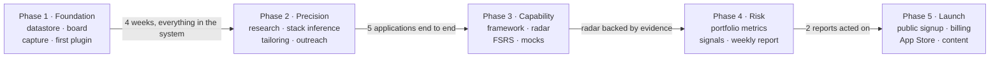

# Roadmap

|                   |                     |
| ----------------- | ------------------- |
| **Status**        | Phase 1 in progress |
| **Last reviewed** | 2026-11-04          |

Build the things used every single day first. The radar and the risk dashboard are
arithmetic over data that does not exist yet, so they cannot come first no matter how
interesting they are.

**Every gate is a usage gate.** "The feature exists" does not pass. "I used it for real for
a week and did not fall back to the old way" passes. Week counts are estimates; the gates
are not.

## Phases

### Phase 1 — Foundation · weeks 1–3

Datastore, the pipeline board, insight capture, the agent runtime wired to a local model,
and one real plugin end to end.

- Supabase project, first migrations, RLS policies, seed data
- `packages/core` with the schema types, and the repository layout from
  [architecture.md](architecture.md#repository-layout)
- Application board with drag-to-stage and append-only `stage_history`
- Application detail view: properties, notes, and the stage as a property
- Manual application creation with `jd-parser`
- Insight capture: web paste box, then the mobile share sheet
- `followup-writer` as the first plugin, with its regression test
- `llm_usage` metering from the very first model call

**Gate:** four consecutive weeks with every application in the system and no spreadsheet.

**Scope cut 2026-11-11.** ATS polling ships as a button, not a schedule. A schedule has
no user, so it needs the service key, which [ADR-0002](adr/0002-use-supabase-as-the-primary-datastore.md)
permits only for scheduler plugins passing an explicit user context — a larger decision
than this function. Running it by hand first is also how the relevance filter gets tuned
against real boards before anything runs unattended: a posting it wrongly discards leaves
no trace, and that is a bad property to automate before it has been watched. The schedule
is the next step, not an abandoned one.

**Reordered 2026-11-06.** The detail view was not in this list and `jd-parser` was next.
The author used the board, found there was nowhere to put what they knew about an
application, and asked for the detail view first. It jumps the queue because it serves the
gate directly — four weeks of real use needs somewhere to put what real use produces — and
because it is the only way to change a stage that does not involve dragging, which matters
while touch dragging is unverified. `jd-parser` follows it.

### Phase 2 — Precision applying · weeks 4–6

- `company-research` with the fixed `research_json` shape and 30-day caching
- `stack-inference` cross-validating three signals with per-item confidence
- Master résumé in JSON Resume, Typst templates for UK/IE and Japan
- `resume-tailor` plus the bullet-by-bullet diff UI
- Match scoring and the missing-skills list
- Role mapping and outreach drafting
- UK licensed-sponsor register ingestion

**Gate:** five tier-A applications taken end to end through the system, and the Japanese
document template used for at least one real application.

### Phase 3 — Capability · weeks 7–9

- Competency framework content: two axes first, then the rest
- Evidence table wired to interviews, mocks and drills
- Radar with drill-down to the evidence behind each number
- FSRS cards via `ts-fsrs`, daily queue, review screen on mobile
- System-design mock interviews with rubric scoring

**Gate:** a radar where every visible score traces to real evidence, with no
self-assessment entries.

### Phase 4 — Risk · weeks 10–12

- Portfolio metrics, including region concentration and sponsorship coverage
- Signal scanning on a schedule, with the headcount time series
- Weekly portfolio report
- Insight sparring and the pre-interview push
- Sankey funnel export

**Gate:** two consecutive weekly reports that actually changed what got applied to.

### Phase 5 — Launch · week 13 onward

- Public web signup, multi-tenant verification, quotas
- Subscriptions, and the free-tier allowance
- Privacy policy, terms, data export and deletion
- Error tracking, uptime monitoring, a runbook
- Mobile app to TestFlight, then the App Store
- Build-in-public content cadence

**Gate:** 20 active users who are not the author.

See [launch.md](launch.md) for everything this phase needs that is not code.

## What is deliberately not being built

Saying no in writing is what keeps the phases finishable.

| Not building                                | Why                                                                                                   |
| ------------------------------------------- | ----------------------------------------------------------------------------------------------------- |
| Auto-submission of applications             | A product stance, not a limitation. See the non-goals in [architecture.md](architecture.md#non-goals) |
| A Telegram bot                              | The share sheet is faster where it counts; two capture surfaces is double maintenance for one user    |
| Any LinkedIn automation                     | Non-negotiable                                                                                        |
| Microservices, Kubernetes, a message broker | One developer, one user. The internal boundaries are where a split would go if it were ever needed    |
| A documentation site                        | Nothing to document for users until Phase 5                                                           |
| Model fine-tuning                           | Prompts and configuration do the job                                                                  |
| Germany                                     | Wave 2, after the Japan track generalises ([regions.md](regions.md))                                  |

## Re-planning rule

If a gate is missed, the response is to fix the current phase, not to start the next one.
Two missed gates in a row means the scope of the phase was wrong — cut it, write down what
was cut and why, and re-gate. Record the decision as an ADR if it changes a boundary; this
document just gets edited.
